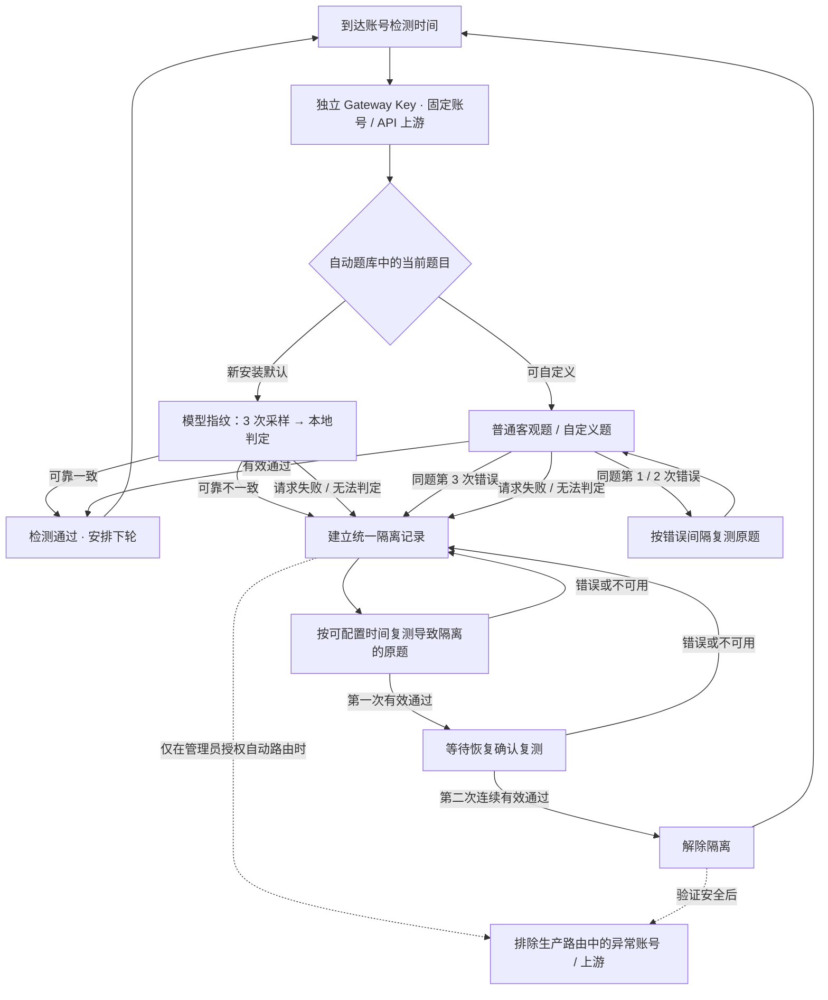

# Magpie Codex Guard

**基于模型指纹的 Codex 降智检测与账号隔离插件**

适用于 [Magpie](https://github.com/yetone/magpie) · 非官方插件 · 支持 Codex 账号与显式登记的 API 上游

> **默认根据模型指纹检测结果判断是否降智。** 对全新安装（无已有 Guard 数据库），自动题库默认选中 **模型指纹检测**：每轮对固定账号发送 3 次采样请求，使用本地模型指纹参考库判定响应是否与预期模型一致。一次完整、可靠的不一致即可触发隔离。其他客观题可自行选择、组合或轮换。
>
> **默认判断依据 ≠ 自动启用生产封禁。** 定时检测和修改生产 Gateway Key 路由都需由管理员显式开启；插件初始为观察模式。升级已有安装不会覆盖原来的题库、隔离记录或检测时间。

[安装说明](#安装与首次配置) · [检测原理](#检测原理与工作流程) · [隔离规则](#隔离与恢复规则) · [自定义时间](#自定义检测时间) · [安全说明](#生产环境与安全边界)

## 主要能力

| 功能 | 当前行为 |
| --- | --- |
| **默认指纹判断降智** | 全新安装默认选择模型指纹题；本地评分，不依赖第三方在线判分服务 |
| 指纹客观题 | **3 次上游采样 = 1 次检测判定**；可靠不一致，一轮立即隔离 |
| 其他客观题 | 牛奶推理与符合自动判分要求的自定义题（包括自行添加的糖果题）可并列勾选；同一道题连续 3 次有效答错隔离 |
| 检测不可用 | 自动检测请求失败、429、超时、指纹无法判定或采样不足时，**立即隔离**；不计为回答错误 |
| 统一恢复 | 隔离后复测原题，连续 **2 次有效通过**才能恢复 |
| 时间自定义 | 全局或单个监测目标设置正常检测、错误复测、隔离复测、恢复确认、不可用重试、请求超时等 |
| 安全路由 | 使用独立检测 Gateway Key；可选自动从受管理的生产 Key 路由中排除异常账号；保留紧急恢复 |
| 持久化 | SQLite 保存判定、隔离、下一次复测时间、题库与时间配置；服务重启不清空 |
| API 上游 | 支持显式登记的 Magpie API 上游检测；API 供应商的隔离作用于整个供应商范围 |

**项目不会删除或修改 Codex OAuth 登录凭证，也不会代替 Magpie 提供模型服务。**

## 安装与首次配置

在 **Magpie → 设置 → 插件** 中搜索 `magpie-codex-guard`，或在 GitHub 插件安装入口填写：

```text
github:Dsd1001/magpie-codex-guard
```

也可通过 Magpie CLI 安装：

```sh
magpie plugin add github:Dsd1001/magpie-codex-guard
```

**首次配置步骤：**

1. 在 Magpie 中创建独立的 **检测 Gateway Key**，确保它有权限调用待检测账号及模型。不要用生产业务 Key 代替。
2. 从插件的「登录 / 打开管理控制台」入口进入 Guard。远程 VPS 可以使用插件提供的临时 Cloudflare HTTPS 控制台。
3. 在 **「设置与路由 → 检测连接」** 填写 Gateway URL、检测 Key 的 Secret 和每日请求预算。
4. 在 **「账号监测」** 添加 Codex 账号与检测模型，或同步 Magpie 已登录账号。检测目标必须明确选择；安装插件不会自动扫描和禁用所有账号。
5. 在 **「检测题库」** 查看默认选中的「模型指纹检测」，确认参考模型映射正常；也可选牛奶推理、糖果题或其他自定义客观题，并可手动测试。
6. 在 **「设置与路由」** 开启定时检测。先使用**观察模式**查看历史检测结果；只有在确认路由范围和预期账号数量无误后，才显式开启生产自动隔离。

**升级注意：** 全新安装默认指纹检测；已有 Guard 数据库的安装继续使用其原有自动题库，不会被强制改成指纹模式。若希望旧安装也以指纹为默认判定依据，请在「检测题库」只勾选「模型指纹检测」并保存。

## 检测原理与工作流程

Guard 不拦截每一个业务请求，而是在后台通过**独立的检测 Gateway Key** 对固定监测目标主动采样。检测使用 Magpie 原生模型 ID 和 `X-Magpie-Account` 绑定账号，不能失败后自动回退到别的账号。

**模型指纹是默认降智判定依据：**

1. 按检测时间对目标账号发起一轮指纹题，包含 **3 次独立采样请求**。
2. 使用内置的 `lm-detector shared-detector-v2` 参考库，在本地比较 3 份输出与预期模型指纹。
3. **`match`（一致）**：记为通过；**`mismatch`（可靠不一致）**：当轮立即隔离；**`indeterminate` / 采样失败 / 无参考模型**：记为检测不可用，并按当前不可用隔离规则处理。
4. 预期参考模型通常根据实际检测模型**自动匹配**，无需再额外配置一个预期模型。无法匹配时，可在手动检测区的高级参考映射中进行设置。

指纹评分体现的是**参考库内模型行为的统计差异**，不是对模型身份的密码学证明，也不能保证在任何模型或网络条件下都绝对准确。使用前应确认所选检测模型在本地参考库中有合适的映射。



**没有单独的“指纹复核”或“高、中、低风险”阶段。** 指纹题与普通客观题在同一题库并列，只有各自的错误隔离阈值不同。手动指纹检测只写入历史记录，不改变隔离状态。

## 隔离与恢复规则

| 自动检测结果 | 处理方式 |
| --- | --- |
| 指纹题可靠一致 | 通过，安排正常检测 |
| **指纹题可靠不一致** | **一轮隔离**（该轮已经采样 3 次，无需再进行多轮指纹复核） |
| 普通客观题第 1 / 2 次错误 | 保持原题，按错误复测间隔继续检测 |
| **普通客观题同题连续 3 次错误** | **隔离** |
| **HTTP 429、超时、请求异常、无法判分、指纹样本不足或无参考映射** | **立即隔离**，不累计回答错误次数 |
| 隔离后第一次有效通过 | 保持隔离，进入恢复确认 |
| **原题连续 2 次有效通过** | **解除隔离** |
| 隔离中再次错误或检测不可用 | 保持隔离；不可用会中断恢复连续通过计数 |

隔离采用一个统一状态，不再区分高低风险。**不可用不等于已证实降智**：插件为了避免未经成功检测的账号继续进入受管理路由，采取保守隔离。由于这一规则较严格，首次启用建议先观察 429、网络故障和参考库映射情况。

## 自定义检测时间

管理控制台：**「设置与路由 → 自动检测时间策略」**。

| 可配置项 | 默认值 |
| --- | ---: |
| 正常检测周期 | 30 分钟 |
| 普通客观题错误复测 | 2 分钟 |
| 隔离首次复测 | 6 小时 |
| 隔离后续复测 | 24 小时 |
| 恢复二次确认 | 2 分钟 |
| **检测不可用隔离复测** | **30 分钟** |
| 单次上游请求超时 | 180 秒 |
| 后台扫描间隔（全局） | 60 秒 |

可以按**全局默认**或**单账号 + 模型 / API 监测目标**独立配置。修改默认不覆盖已经排好的检测时间；需要立即重新计算时可以勾选「保存后重新计算尚未执行的检测时间」。每日请求预算仍然生效。

一次指纹题会发送 3 次上游请求；若设定的检测时间过短，应同时考虑检测 Key 额度、429 概率以及潜在的不可用隔离。

## 生产路由与安全边界

- **默认观察模式。** 安装和选择指纹题不会自动修改生产 Gateway Key。必须先启用定时检测，并单独确认生产路由自动隔离。
- **Codex 账号级隔离。** 将异常账号从受管理生产 Gateway Key 的账号允许范围排除，不删除登录身份；检测 Key 仍可继续复测。
- **API 上游隔离。** 对显式登记的 API Key 固定检测，但当前路由隔离粒度为**整个 Provider**（可能影响同一 Provider 下的其他 Key、模型）。详见 [API 上游监测说明](docs/api-upstreams.md)。
- **全部账号被隔离时**，因 Magpie 空白名单代表“允许全部”，控制器在安全条件允许时会暂时关闭受影响的生产 Key，而不是写入空白名单使账号意外放行。其他共用该 Key 的业务可能受影响。
- **外部路由修改保护。** 检测到生产白名单扩大、权限冲突或写前日志问题时不会盲目覆盖，需管理员检查、确认当前白名单或使用紧急恢复功能。
- **数据保留。** 隔离状态、复测期限、历史与自定义时间存入专用 SQLite；账号删除后仍保留隔离留档，重启不会自动解除。
- **不保证所有入口都受到拦截。** 只有通过已纳入管理的生产 Gateway Key 的调用受控；直接调用其他入口不受影响。

## 安装包与版本

当前开发版：**`v0.1.0-alpha.25`**（新安装默认使用模型指纹判断降智，GitHub 直接安装和完整 Release 安装均使用新版后端）。

[GitHub Releases](https://github.com/Dsd1001/magpie-codex-guard/releases) · [详细架构](docs/architecture.md)

Magpie 使用 `github:Dsd1001/magpie-codex-guard` 源码安装时，插件会从已发布的 Release 获取所需 Go 二进制，使用**固定 SHA-256** 校验安装包及可执行文件；完整 Release 包则优先使用内置二进制。支持 Linux AMD64、Linux ARM64 和 macOS ARM64，首次下载安装需要访问 GitHub Release 并具备 `tar`。

**安装器版本说明：** 从 Magpie 通过 GitHub 源码安装时，安装器固定下载并校验已发布的 `v0.1.0-alpha.24` Go 后端；alpha.25 完整 Release 包内含本版 Go 后端。因此两种安装方式都支持“新安装默认指纹判断降智”，且升级既有数据库不会重置原选题。

远程管理可使用插件提供的临时 Cloudflare Quick Tunnel，生成一次性 HTTPS 管理链接；无需自行配置 Cloudflare DNS。管理链接应视同管理员凭证，不要公开分享。

## 测试与致谢

- `go test ./... -count=1`、`go vet ./...`：检测规则、自动选题、统一隔离、恢复、时间策略、SQLite 持久化、路由安全及旧版状态迁移。
- GitHub Actions 同时运行管理界面测试，并构建 Linux/macOS 预编译安装包。
- 指纹逻辑基于 [lm-detector](https://github.com/Ikaleio/lm-detector) 的公开参考数据与本地评分实现。感谢上游作者；本项目并非 Magpie 或 lm-detector 的官方插件。
- 插件仅针对模型质量监测和受管理的路由隔离，不提供模型供应或订阅账号授权服务。

**建议上线顺序：先校验参考映射 → 手动指纹检测 → 开定时检测（观察）→ 核验历史和隔离预览 → 最后手动启用生产自动隔离。**

许可证与授权详情请参阅 [LICENSE](LICENSE)。
