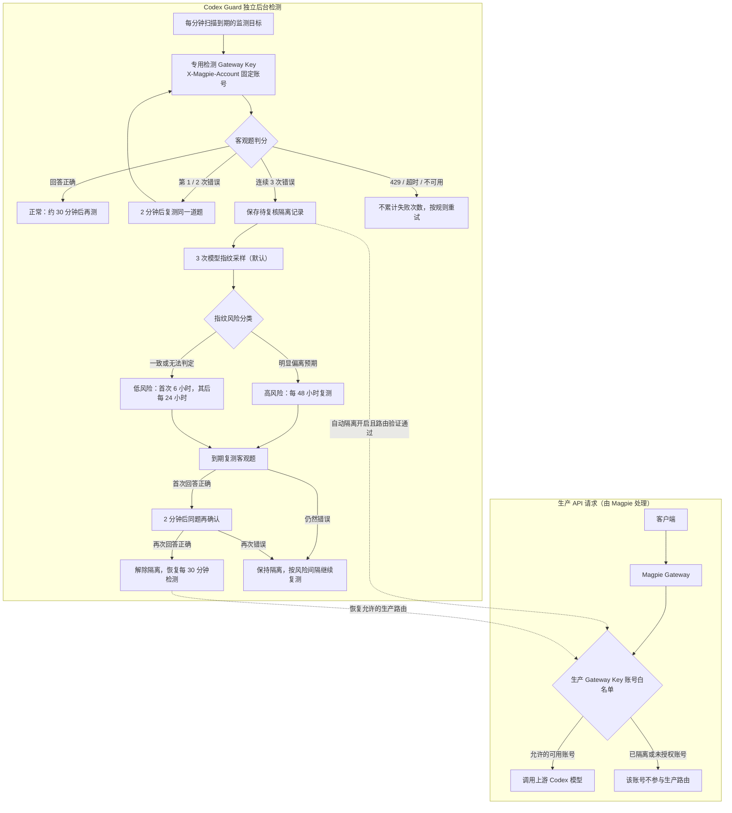

# Magpie Codex Guard

**非官方 Magpie 插件 · Codex 账号级质量监测与安全隔离**

*An unofficial Magpie plugin for per-account Codex quality checks, local fingerprint verification, and safe Gateway Key quarantine.*

Codex Guard 按 **Codex 登录账号** 检测：使用独立检测 Key 通过客观题与模型指纹采样自动检测降智，并自动将风险账号从生产 Gateway Key 的调用清单中排除。它**不会删除账号或修改 OAuth 凭证**，也不是新的模型供应商。

**当前插件版本：** `0.1.0-alpha.19`（GitHub 源码安装固定校验并下载 `v0.1.0-alpha.18` Go 后端；alpha.19 Release 完整包内含预编译后端）。目前仍属开发测试版本，请先验证检测准确性，再开启生产路由自动隔离。

## 快速安装

可以在 **Magpie → 设置 → 插件 → 发现 → 非官方插件 · GitHub** 中查找 **Magpie Codex Guard**（仓库添加 `magpie-plugin` Topic 并被 GitHub 索引后可见）。也可以直接在「已有想装的？」中填写：

```text
github:Dsd1001/magpie-codex-guard
```

**安装后按下面顺序配置：**

1. 在 Magpie 中准备一个**独立的检测 Gateway Key**，不要直接把生产业务 Key 当作检测 Key。检测连接输入的是 **Key Secret**；「专用检测 Key」下拉框选择的是该 Key 对象。
2. 在插件登录入口打开管理控制台：服务器本机访问可用本地地址，远程 VPS 请选「打开临时远程控制台（Cloudflare）」；不要在自己电脑浏览器里直接打开 VPS 的 `127.0.0.1`。
3. 在「账号监测」添加要监测的 Codex 登录账号和模型，在「检测题库」选择自动客观题并先进行手动测试。
4. 在「设置与路由」核对 **预期 Codex 账号数量**、独立检测 Key 与生产白名单。**只有明确勾选并确认后**，插件才允许自动修改生产 Gateway Key 的账号路由。
5. Magpie 增删 Codex 登录账号后，可点「同步 Magpie 账号」，或显式开启监测目标自动同步；如果你手动给生产 Key **增加**账号，还须点击「确认采用当前白名单」，由插件核对当前隔离状态后才更新私有路由基线。

详细原理、隔离间隔、安全限制和开发说明见下文。登录入口**仅用于打开管理控制台**，不会请求你授权其他第三方供应商。

## 功能概览

| 功能 | 具体行为 |
| --- | --- |
| 按账号检测 | 正常账号约每 30 分钟检测；客观题连续两次错误会以 2 分钟间隔复核，第三次错误后开始隔离流程 |
| 本地指纹复核 | 每轮 3 次采样，本地评分；指纹无法可靠识别不等于客观题错误 |
| 风险隔离与恢复 | 高风险每 48 小时复测；低风险首次 6 小时，之后每 24 小时复测；连续两次正确且相隔约 2 分钟解除隔离 |
| 自定义题库 | 支持自定义客观题、多选轮换、手动检测与自动检测分别配置 |
| 账号增删与白名单 | 旧隔离账号删除后仍留档、停止无效检测；新增监测目标可选自动同步；生产白名单扩大须管理员确认 |
| 安全约束 | 只管理受控生产 Gateway Key；检测 Key 独立使用；冲突时拒绝危险的路由写入，持久化状态可在重启后恢复 |

## 工作流程

Codex Guard 使用 **旁路质量检测 + 可选的生产路由隔离**，而不是对每次业务请求同步执行 `quality-check` 门禁。客户端仍直接调用 Magpie；**未检测或到期并不会由本插件直接返回 HTTP 403**。只有管理员明确启用自动隔离、并且路由安全校验成功时，检测结果才会改变受管理的生产 Gateway Key 白名单。



### API 上游检测

支持显式登记 Magpie API 上游，按指定 API Key 采样和自动判分。正常和不可用目标每 30 分钟检测；自动隔离以整个供应商为单位，保留专用检测 Key 的恢复访问。登记方法、隔离边界及安装包要求见 [API 上游说明](docs/api-upstreams.md)。

### 检测是怎么运行的？

1. **按账号独立采样。** 定时调度器约每分钟扫描一次任务，只在目标到期时调用独立的检测 Gateway Key，使用 `X-Magpie-Account` 固定 Codex 登录账号；正常账号约每 30 分钟检测一道自动客观题。检测和业务请求不共用 Key，也不需要客户端等待。
2. **连续错误才升级。** 首次、第二次客观题回答错误，都在约 2 分钟后复测同一道题；第三次连续错误才建立隔离记录，并按配置进行模型指纹复核。429、网络超时或不可用不会被当成回答错误。
3. **指纹决定复测间隔。** 默认每轮采集 3 次指纹：明显偏离预期按高风险（每 48 小时复测），一致或无法判定按低风险（首次 6 小时，之后每 24 小时复测）。若关闭自动指纹，异常账号保守按低风险处理。
4. **两次确认后解除隔离。** 隔离账号到期复测首次正确后，约 2 分钟再次验证；连续两次正确才解除隔离。检测历史、隔离原因、风险等级和下次检测时间会持久化保存，重启不会重新计算倒计时。
5. **生产路由可独立关闭。** 默认观察模式只记录检测与隔离状态，**不会擅自修改生产 Gateway Key**。启用自动隔离后，插件仅在确认路由安全时排除异常账号；若管理员更改了白名单，插件不会直接覆盖可能扩权的变更。

**手动客观题、手动指纹，以及可选的正常账号每 24 小时周期指纹**，只记录检测结果，不直接增加连续失败次数或改变生产路由。只有被纳入管理的生产 Gateway Key 受隔离影响；如果该 Key 已没有任何可用的 Codex 账号，安全策略可能暂时停用整个 Key，具体见下文「所有账号都被隔离时会怎样？」。

## 只做 Codex 账号检测

- 从 Magpie 的 `logins.json` 只读提取 Codex 账号稳定 ID 和邮箱，**不导出 OAuth 凭证**。
- 「检测模型」直接读取 Magpie 自带的 `magpie models codex` 目录，显示当前实例中的 Codex 模型；**无需先配置检测 Key 才能选模型**。若本机无 Magpie CLI，则回退到已配置检测网关的 `/v1/models`。查询失败会在界面显示原因。
- 添加监测目标与真正发起检测分离：**实际探针仍必须配置独立检测 Gateway Key**，不会借用或暴露生产 Key。
- 每次通过独立 Gateway Key 的 `X-Magpie-Account` 固定一个订阅账号，账号无法解析就取消请求，不允许随机切换。检测请求使用原生 `codex/<model>` 名称，不再使用 `quality-probe/` 前缀，也不写入全局模型中间件；否则 Magpie 会对未知别名返回 HTTP 404。
- 统一检测题库：保留牛奶题和可配置的自定义自动判分题，并新增内置「模型指纹检测」（指纹题类型）。客观题支持多选与顺序轮换；失败及隔离后始终复测同一题。指纹不能进入客观题错误次数统计。
- **连续 3 次客观题错误**后，先进入隔离流程；默认执行 3 次指纹采样用于高/低风险分类。若在题库中显式关闭自动指纹，则不发指纹请求，保守按低风险处理；生产路由变更仍必须独立启用并确保隔离成功。
- Go 本地评分：使用固定版本的 `lm-detector shared-detector-v2`（60 个候选模型），不依赖官网评分 API，也不向外部评分服务发送账号或 Gateway Key。
- 自动隔离影响全部已管理的生产 Gateway Key，**检测专用 Key 保持可用**；不删除、不停用 Codex 登录本身。
- **管理员主动收缩白名单不会再导致全部检测停摆**：只接受现有显式白名单的顺序保留删除（不可变空、不可新增账号、不可更改启停状态），必须先用实时路由确认所有隔离账号仍被排除，才把收缩同步到插件私有基线并写审计日志；此操作不改写 Magpie Gateway Key 文件。未来解除隔离也不会恢复管理员移除的账号。
- 若外部修改涉及扩权、启停变化或不安全隔离，仍禁止自动路由覆盖；只有在可从实时 Key 文件验证全部隔离安全时，其他正常账号的**只读检测**可以继续运行，并禁止在此模式中产生可能无法执行的新隔离。
- **账号替换可恢复**：旧 Codex 登录已删除而仍有高/低风险隔离时，插件保留原稳定 ID 与隔离历史（删除留档），跳过已不存在账号的自动检测，并持续阻止该 ID 重新进入业务路由。Magpie 恢复此 ID 时隔离仍有效，不会错误解除。需要同步监测目标可点击「同步 Magpie 账号」，选择性开启「账号增删后自动同步监测目标」（会增加新登录账号的检测请求）。
- 如果管理员在 Magpie 生产 Key 白名单中**主动加入新的、已登录且未被隔离的 Codex 账号**，可以在「设置与路由」点击「确认采用当前白名单」，在安全复核和明确确认后，仅更新内部基线和审计记录；此动作**不会写 Gateway Key 文件、不会清空旧隔离**，被删除的旧账号也不会从基线意外恢复。未知账号、被隔离账号、禁用状态变化与空白名单始终拒绝。
- 账号历史、两种风险级别和下次复测时间写入专用 SQLite 数据目录，服务重启后原样继续。

不再提供原插件的模型级质量门禁、模型级测试或 HTML/SVG 输出预览。**Cloudflare 远程控制台直接沿用原 Account Intelligence Check 的 Go 控制台与一次性会话机制**，不再使用独立 Node HTTP 代理。

## 检测题库中的指纹检测

「检测题库」统一展示客观题和内置指纹题，**两种类型独立评分**。从「手动检测」选择监测账号、检测模型与「模型指纹检测」即可执行 3 次随机数字序列采样，并在检测历史中查看 `match / mismatch / indeterminate`、候选模型相对概率、使用的参考库版本以及实际样本数。可以为指定监测账号保存本地参考库支持的预期模型。手动指纹**只记录结果，不会改变客观题连续错误次数、隔离状态或生产路由**。

指纹自动触发模式：

- **连续 3 次客观题错误后复核**（默认，升级时保留此前行为）：先隔离，再通过 3 次指纹采样确定高/低风险。
- **异常复核 + 正常账号每 24 小时检测**（必须手动开启）：保留异常指纹复核，同时为客观题正常、未隔离的账号额外每 24 小时执行一轮 3 次采样。周期指纹只记录结果，不直接控制隔离；启用后首次周期任务最早 24 小时后到期，周期计时持久化到 SQLite。
- **作为自动客观题参与轮换**（新增，**必须主动选择**）：将指纹作为一项自动检测题，与牛奶题、糖果题等所选客观题按轮次交替；也可取消全部客观题，仅用指纹检测。每轮指纹发送 3 个独立请求，但**最终只算一次自动题目判分**：预期参考模型与检测结果一致记通过，明确强不一致记错误，采样不足、超时或无法判定记不可用（不累计失败）。同一检测题连续 3 次可靠失败才触发原有隔离和指纹风险分级；重新确认失败期间仍复测同一题。混合轮换时必须勾选「按轮次顺序轮换」，并**提前为每个账号单独保存指纹预期参考模型**，否则该账号不会发送自动指纹挑战，也不会因缺失参考模型被误判为失败。统计指纹存在误判概率，建议先在观察模式验证。
- **关闭自动指纹**：手动指纹仍可使用；客观题连续 3 次错误时按低风险隔离，不发送指纹挑战，保持客观题恢复规则。

所有模式均需要配置独立检测 Gateway Key，且账号按 `X-Magpie-Account` 固定。**每轮的 3 个指纹原始采样不分别计为失败**；只有启用「作为自动客观题参与轮换」时，最终可靠的 `mismatch` 才可计作**一轮**自动检测失败。其他指纹模式仍不影响连续错误次数。注意周期模式每个健康账号额外消耗 **3 次上游请求/24 小时**。

## 隔离和恢复规则

| 场景 | 行为 |
|---|---|
| 正常账号 | 每 30 分钟检测一次客观题 |
| 客观题第 1、2 次错误 | 相同题目每 2 分钟复测 |
| 连续 3 次有效回答错误 | 保存持久化隔离记录；开启生产自动隔离时先同步 Key 路由，然后按题库设置复核指纹（关闭指纹则保守判低风险） |
| 指纹明确强烈偏离预期类别 | **高风险**：固定每 48 小时复测（0、48、96、144h……） |
| 指纹与预期一致，或无法判定 / 采样不足 / 超时 | **低风险**：首次隔离 6 小时，此后每 24 小时（0、6、30、54h……） |
| 到期复测首次客观题正确 | 2 分钟后使用同一客观题确认 |
| 连续 2 次有效回答正确 | 取消持久化隔离并立即恢复允许的生产账号路由 |
| 429、超时、HTTP 不可用 | 不算客观题失败，不算恢复成功；按中性重试处理 |

**每轮指纹检测需要 3 次独立请求，不能把 3 个回答算成 3 次错误；新模式以整轮指纹判分作为一次客观题。** 账号的 `NextCheckAt`、隔离起始时间、风险等级和指纹库版本均持久保存。

### 所有账号都被隔离时会怎样？

Magpie 的 Gateway Key 账号白名单遵循 **“空列表允许全部账号”**，且仅列出其他 Provider 的账号也不会禁止 Codex，因此绝不写入空白名单或伪造不存在的 Codex ID。

如果某个生产 Key 已没有任何允许的健康 Codex 账号，**Codex Guard 会把该生产 Key 暂时设为 `off=true`**；这会使该 Key 关联的其他 Provider API 也一起暂停。专用检测 Key 始终保持启用状态。健康账号恢复后，插件还原该 Key 最初的 `off` 状态和账号范围；原本就停用的 Key 不会被误开启。全部变更使用 Magpie 相同的文件锁、原子写入、写前日志和写后验证。

只有**通过受管理的 Gateway Key** 进入的业务 API 会受到限制。绕过这些 Key 的直连、未管理的 API 入口不受本插件保证。

## 直接在 Magpie 中安装（GitHub）

**版本说明：** 当前插件为 `0.1.0-alpha.19`。修复 GitHub 源码安装器的后端版本滞后：现在固定 SHA-256 校验 `v0.1.0-alpha.18` Go 后端，支持 Codex 账号检测、指纹作为自动题目，以及新加入的 API 上游监测与隔离。alpha.19 Release 完整包包含重新构建的后端程序；源码安装的后端 Release 与插件版本不同是预期行为。已有配置及隔离状态不应被版本升级自动清空；升级后请重新打开临时管理控制台，并核对当前路由配置。

在 **Magpie → 设置 → 插件** 页面底部的「已有想装的？」输入框中粘贴：

```text
github:Dsd1001/magpie-codex-guard
```

点击「安装」。也可在运行 Magpie 的环境里使用：

```sh
magpie plugin add github:Dsd1001/magpie-codex-guard
```

**不需要**手工下载 Release、执行 Go 构建或运行 npm。Magpie 通过 Bun 获取 GitHub 仓库，且不会执行包的安装脚本；本插件在首次启动时从 [v0.1.0-alpha.18 Release](https://github.com/Dsd1001/magpie-codex-guard/releases/tag/v0.1.0-alpha.18) 下载所需的预编译程序，对安装包以及三个平台二进制分别校验固定 SHA-256，之后缓存在按后端版本隔离的数据目录中。后续启动直接复用缓存。支持 Linux AMD64、Linux ARM64 和 macOS ARM64，其他平台目前不受支持。**首次启动必须能访问 GitHub Release 下载地址，且容器内需要 `tar`。** 此处使用已经发布并校验的 alpha.18 后端，是为了避免源码安装器依赖尚未发布的 Release；直接安装 alpha.19 Release 完整包时则使用包内的后端程序。

**生产环境警告：** 安装不等于立即启用自动隔离；应先保持观察模式，不要让旧版与新版同时写入生产 Gateway Key。需要配置独立的检测 Gateway Key 并完成真实账号安全校验后，才能手动启用自动路由。

**Docker 远程控制台：** 在 Magpie 的插件登录列表中，选择 **「打开临时远程控制台（Cloudflare）」**，等待生成 `https://随机子域名.trycloudflare.com/open/...` 一次性链接，在自己浏览器打开即可；不要选择只适用于服务器本机的 `127.0.0.1` 入口。首次使用时自动下载校验 Cloudflare 官方 `cloudflared 2026.10.0`，无需 Cloudflare 账号、额外 DNS 记录或暴露入站端口。远程临时隧道最长 30 分钟，管理链接 10 分钟内有效且只能使用一次，登录会话 30 分钟自动过期。插件会在外网健康检查通过后才返回链接。

注意：Cloudflare 承担 HTTPS 转发，控制台内可修改业务路由，因此一次性链接视为管理凭证，不能公开分享。**Go 控制台始终监听 `127.0.0.1`，Cloudflare 官方客户端直接将随机 HTTPS 域名转发到该端口**；Go 服务复用原插件已验证的 Host/Origin、一次性登录和会话校验逻辑。测试期间请先保持**自动隔离关闭**；升级已安装的 Codex Guard 后，必须重新进入插件登录流程，旧的本机 URL 不能变成公网 URL。


### 上线前安全要求

1. 备份生产 `caller-keys.json`、旧插件数据库和历史隔离列表。
2. 完成服务隔离的迁移窗口，确保旧、新插件 **不会同时修改相同生产 Gateway Key**。在确认新插件接管之前，必要时暂停业务 Gateway Key，避免临时放行旧隔离账号。
3. 确认 Magpie 版本支持稳定账号 ID、专用 Gateway Key、`X-Magpie-Account` 固定账号和文件锁语义。
4. 先开 **观察模式**。用真实账号验证指纹预测、风险分级和容器资源上限，再显式启用自动隔离。
5. 模型指纹是参考库内相对统计排名，**不是账号身份的密码学验证**。当前高风险阈值为候选排名首位概率至少 0.90 且预期类别概率低于 0.03；这些阈值尚未经你的真实账号样本验证。
6. 预留管理后台的紧急恢复能力。发生外部改动或写前日志未结束时停止自动覆盖并要求人工核对。

## 测试覆盖

- 多账号固定路由：3 次客观题失败 + 3 次指纹采样、生产白名单同步、2 次客观题恢复。
- 低风险首次 6 小时后 24 小时、高风险固定 48 小时、重启后保留持久状态。
- 所有账号异常时生产 Key 停用、部分恢复后安全启用、原本停用的 Key 不得意外开启。
- 并发竞态检测、管理员外部修改冲突、专用检测 Key 不受生产隔离影响。
- 采样遇到 429 时强制为指纹无法判定，按低风险处理且计入实际发起的请求数。
- **16 组真实公开参考回答**与 lm-detector 原版 JavaScript 校准分数及候选排序对比（容许数值误差 1e-6）。
- 使用 jsdom 的浏览器 DOM 模拟测试：邮箱文本安全、手动账号选择、题库保存、路由预览（尚未在实际浏览器人工验收）。

- 复用原插件 Go Quick Tunnel 生命周期和浏览器会话测试；`/api/console` 仅允许插件控制令牌使用，公网页面无法签发新链接。单独的 Node HTTP 代理已移除。

详见 [设计与迁移说明](docs/architecture.md)。

## 许可证与致谢

MIT。原插件源码的许可声明见 [LICENSE](LICENSE)，lm-detector 评分算法和参考数据的许可声明见 [licenses/lm-detector.MIT.txt](licenses/lm-detector.MIT.txt)，自动下载的 Cloudflare 官方 `cloudflared` 使用 Apache 2.0，完整许可文本见 [licenses/cloudflared.apache2.txt](licenses/cloudflared.apache2.txt)。上游是算法/数据的来源，**不提供远程评分 API**，本项目不会向上游站点发送生产 Key。
