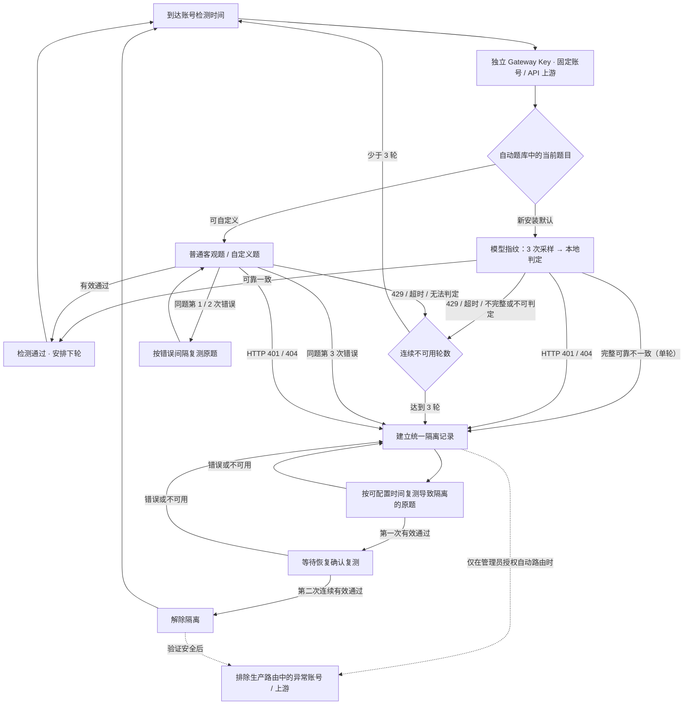

# Magpie Codex Guard

**基于模型指纹的 Codex 降智检测与账号隔离插件**

适用于 [Magpie](https://github.com/yetone/magpie) · 非官方插件 · 支持 Codex 账号与显式登记的 API 上游

> **默认根据模型指纹检测结果判断是否降智。** 对全新安装（无已有 Guard 数据库），自动题库默认选中 **模型指纹检测**：每轮对固定账号发送 3 次采样请求，使用本地模型指纹参考库判定响应是否与预期模型一致。一轮三次有效采样且可靠不一致立即隔离；429／超时等连续三轮不可用才隔离，401／404 立即隔离。其他客观题可自行选择、组合或轮换。
>
> **默认判断依据 ≠ 自动启用生产封禁。** 定时检测和修改生产 Gateway Key 路由都需由管理员显式开启；插件初始为观察模式。升级已有安装不会覆盖原来的题库、隔离记录或检测时间。

[安装说明](#安装与首次配置) · [检测原理](#检测原理与工作流程) · [隔离规则](#隔离与恢复规则) · [自定义时间](#自定义检测时间) · [安全说明](#生产环境与安全边界)

## 主要能力

| 功能 | 当前行为 |
| --- | --- |
| **默认指纹判断降智** | 全新安装默认选择模型指纹题；本地评分，不依赖第三方在线判分服务 |
| 指纹客观题 | **3 次上游采样 = 1 次检测判定**；连续 3 轮可靠不一致才隔离 |
| 其他客观题 | 牛奶推理与符合自动判分要求的自定义题（包括自行添加的糖果题）可并列勾选；同一道题连续 3 次有效答错隔离 |
| 检测不可用 | 自动检测请求失败、429、超时、指纹无法判定或采样不足时，**先重试，连续 3 轮不可用才隔离**；不计为回答错误 |
| 统一恢复 | 隔离后复测原题，连续 **2 次有效通过**才能恢复 |
| 时间自定义 | 全局或单个监测目标设置正常检测、错误复测、隔离复测、恢复确认、不可用重试、请求超时等 |
| 安全路由 | 使用独立检测 Gateway Key；可选自动从受管理的生产 Key 路由中排除异常账号；保留紧急恢复 |
| 一键重置全部账号 | 「账号监测」页面可手动重置全部隔离／检测状态，同时恢复受管理的生产 Key 白名单及启用状态、暂停定时检测与自动隔离；检测历史与配置保留 |
| 持久化 | SQLite 保存判定、隔离、下一次复测时间、题库与时间配置；服务重启不清空 |
| API 上游 | 支持显式登记的 Magpie API 上游检测；API 供应商的隔离作用于整个供应商范围 |

**项目不会删除或修改 Codex OAuth 登录凭证，也不会代替 Magpie 提供模型服务。**

## 安装与首次配置

在 **Magpie → 设置 → 插件** 中搜索 `magpie-codex-guard`，或在 GitHub 插件安装入口填写：

```text
github:Dsd1001/magpie-codex-guard
```

也可通过 Magpie CLI 安装：

```sh
magpie plugin add github:Dsd1001/magpie-codex-guard
```

**首次配置步骤：**

1. 在 Magpie 中创建独立的 **检测 Gateway Key**，确保它有权限调用待检测账号及模型。不要用生产业务 Key 代替。
2. 从插件的「登录 / 打开管理控制台」入口进入 Guard。远程 VPS 可以使用插件提供的临时 Cloudflare HTTPS 控制台。
3. 在 **「设置与路由 → 检测连接」** 填写 Gateway URL、检测 Key 的 Secret 和每日请求预算。
4. 在 **「账号监测」** 添加 Codex 账号与检测模型，或同步 Magpie 已登录账号。检测目标必须明确选择；安装插件不会自动扫描和禁用所有账号。
5. 在 **「检测题库」** 查看默认选中的「模型指纹检测」，确认参考模型映射正常；也可选牛奶推理、糖果题或其他自定义客观题，并可手动测试。
6. 在 **「设置与路由」** 开启定时检测。先使用**观察模式**查看历史检测结果；只有在确认路由范围和预期账号数量无误后，才显式开启生产自动隔离。

**升级注意：** 全新安装默认指纹检测；已有 Guard 数据库的安装继续使用其原有自动题库，不会被强制改成指纹模式。若希望旧安装也以指纹为默认判定依据，请在「检测题库」只勾选「模型指纹检测」并保存。

## 检测原理与工作流程

Guard 不拦截每一个业务请求，而是在后台通过**独立的检测 Gateway Key** 对固定监测目标主动采样。检测使用 Magpie 原生模型 ID 和 `X-Magpie-Account` 绑定账号，不能失败后自动回退到别的账号。

**模型指纹是默认降智判定依据：**

1. 按检测时间对目标账号发起一轮指纹题，包含 **3 次独立采样请求**。
2. 使用内置的 `lm-detector shared-detector-v2` 参考库，在本地比较 3 份输出与预期模型指纹。
3. **`match`（完整、可靠一致）**：记为通过，清除此前累计的不可用次数；**`mismatch`（完整、可靠不一致）**：一轮立即隔离；**`indeterminate` / 429 / 超时 / 采样不完整 / 无参考模型**：记为该题一轮不可用，沿用自定义不可用重试间隔，连续第三轮不可用才隔离；**采样任意一步收到 Gateway HTTP 401/404**：立刻隔离，不等待剩余采样；已有隔离不会因此解除。
4. 预期参考模型通常根据实际检测模型**自动匹配**，无需再额外配置一个预期模型。无法匹配时，可在手动检测区的高级参考映射中进行设置。

指纹评分体现的是**参考库内模型行为的统计差异**，不是对模型身份的密码学证明，也不能保证在任何模型或网络条件下都绝对准确。使用前应确认所选检测模型在本地参考库中有合适的映射。



**没有单独的“指纹复核”或“高、中、低风险”阶段。** 指纹题与普通客观题在同一题库并列，但阈值不同：指纹一轮 3 次有效采样且可靠不一致就隔离，普通客观题需要同题连续 3 次有效错误。手动指纹检测只写入历史记录，不改变隔离状态。

## 指纹库版本与更新

当前内置指纹参考库来自 [Ikaleio/lm-detector](https://github.com/Ikaleio/lm-detector)，固定在上游 **2026-10-27** 的 [`a4ef212d`](https://github.com/Ikaleio/lm-detector/commit/a4ef212df06817e8071acd05f00219f4c9eb2f9a) 提交；参考库构建时间为 `2026-10-27 05:02:50 UTC`，支持 **64 个模型**（上一版为 60 个）。

新增模型：`gpt-6.1-terra`、`kimi-k3.1-pro`、`gemini-3.5-flash-lite`、`minimax-m3.1-flash`。评分器也已同步上游 10 月 24 日修正的数字序列判别规则：只有**两个序列信号都不符合模型输出特征**时才拒绝判分，避免把部分正常回答过早判成“不可判定”。

更新同时重算了 16 组独立上游 JavaScript 评分结果，Go 实现会持续对比其模型预测、排序和概率。内置库**不依赖在线更新**；升级插件到包含新 Go 后端的版本才会更新参考库。完整数据来源、哈希和可复现同步脚本见 [指纹库来源与校验](internal/fingerprint/data/ORIGIN.md)。

**注意：** 参考库更新后，旧模型的相对概率也可能变化；而自动检测不可用会触发隔离。升级后请先在观察模式校验模型映射及检测结果，确认无异常再开启生产路由自动隔离。

## 隔离与恢复规则

| 自动检测结果 | 处理方式 |
| --- | --- |
| 指纹题可靠一致 | 通过，安排正常检测 |
| **指纹题 3 次采样完整、可靠不一致** | **当轮立即隔离**，无需再做指纹复测 |
| 普通客观题第 1 / 2 次错误 | 保持原题，按错误复测间隔继续检测 |
| **普通客观题同题连续 3 次错误** | **隔离** |
| **HTTP 401 / 404（包括单轮指纹采样中途）** | **立即隔离**，不等待下一轮，也不再执行该轮剩余采样 |
| **HTTP 429、超时、其他请求异常、无法判分、指纹样本不足或无参考映射** | 按当前配置重试**同一道题**，连续 3 轮不可用才隔离；与回答错误分别计数 |
| 隔离后第一次有效通过 | 保持隔离，进入恢复确认 |
| **原题连续 2 次有效通过** | **解除隔离** |
| 隔离中再次错误或检测不可用 | 保持隔离；不可用会中断恢复连续通过计数 |

隔离采用一个统一状态，不再区分高低风险。**不可用不等于已证实降智**：前两轮沿用原题及自定义不可用复测时间调度，连续第三轮不可用才隔离。若第二轮恢复为完整有效指纹，一致则通过，不一致则当轮隔离，**无需重新累计三轮错误**。任何有效结果会清零不可用计数，正常通过也清零错误计数。自动隔离中连续 2 次有效通过才能解除。

## 自定义检测时间

管理控制台：**「设置与路由 → 自动检测时间策略」**。

| 可配置项 | 默认值 |
| --- | ---: |
| 正常检测周期 | 30 分钟 |
| 普通客观题错误复测 | 2 分钟 |
| 隔离首次复测 | 6 小时 |
| 隔离后续复测 | 24 小时 |
| 恢复二次确认 | 2 分钟 |
| **检测不可用重试** | **30 分钟** |
| 单次上游请求超时 | 180 秒 |
| 后台扫描间隔（全局） | 60 秒 |

可以按**全局默认**或**单账号 + 模型 / API 监测目标**独立配置。修改默认不覆盖已经排好的检测时间；需要立即重新计算时可以勾选「保存后重新计算尚未执行的检测时间」。每日请求预算仍然生效。

一次指纹题会发送 3 次上游请求；若设定的检测时间过短，应同时考虑检测 Key 额度、429 概率以及潜在的不可用隔离。

## 生产路由与安全边界

- **默认观察模式。** 安装和选择指纹题不会自动修改生产 Gateway Key。必须先启用定时检测，并单独确认生产路由自动隔离。
- **Codex 账号级隔离。** 只从受管理生产 Gateway Key 的 Codex 账号勾选列表移除异常账号，恢复时重新加入；不删除登录身份、不修改其他 Provider 的模型授权，也不改变检测 Key。没有 API 上游隔离时，管理员对 `models` 的独立修改会作为当前授权被安全采纳，不再阻断 Codex 隔离同步。
- **API 上游隔离。** 对显式登记的 API Key 固定检测，但当前路由隔离粒度为**整个 Provider**（可能影响同一 Provider 下的其他 Key、模型）。详见 [API 上游监测说明](docs/api-upstreams.md)。
- **全部 Codex 账号被隔离时**，Magpie 的空白账号白名单代表“允许全部”，不能直接清空。当 Key 有明确的 `codex/*`、`cybersol/*` 等模型权限时，控制器仅临时移除 Codex 模型授权，保持其他 Provider 的既有权限和 Key 启用状态；有可用 Codex 账号后自动还原。若 Key 的模型权限无限制、含路由组别名或无法证明只访问非 Codex 上游，则仍安全关闭该 Key，防止意外放行。对已保存、同时含 Codex 与非 Codex 成员的 `auto/*` 自动路由组，Guard 还会在全部隔离期间**临时将 Codex 成员设为 Off**，保留 cybersol 等独立上游接管；检测 Key 始终可以直接访问隔离账号进行复测。任何账号恢复后，先恢复受管理 Key 的正确账号与模型范围，再只移除 Guard 自己添加的 Off，保留管理员原有的组成员 Off 设置。手动选择（manual）路由组、嵌套组及没有安全非 Codex 备用成员的路由组不会被自动修改。
- **外部路由修改保护。** Codex 账号白名单的非安全扩大仍会被拦截；未受 Guard 模型隔离管理的 `models` 授权由管理员控制。Guard 自身为了全部 Codex 隔离或已登记 API 上游隔离而暂时改变模型权限时，仍严格检查这些临时限制是否被外部绕过。
- **数据保留。** 隔离状态、复测期限、历史与自定义时间存入专用 SQLite；账号删除后仍保留隔离留档，重启不会自动解除。
- **不保证所有入口都受到拦截。** 只有通过已纳入管理的生产 Gateway Key 的调用受控；直接调用其他入口不受影响。

## 手动重置全部账号状态

管理控制台 → **账号监测 → 重置全部账号隔离／检测状态**。该按钮具有**最高优先级**：无需等待正在运行的普通客观题、自动指纹或手动指纹检测结束。点击并确认后会立即取消当前上游检测请求，通过检测代次标记使所有旧协程后续结果失效；即使旧评分器不响应取消，也无法在重置后重新写入检测、隔离或历史记录。确认需输入 `RESET_ALL_ACCOUNT_STATES`，随后执行以下完整恢复：

1. 恢复 Guard 实际管理过的生产 Gateway Key 原始账号／模型白名单及启用状态，并恢复 Guard 管理的自动路由组成员 Off 原始值；不会改写管理员后来新增的、不受 Guard 管理的 Key 或组成员设置。
2. 清除所有账号与已登记 API 上游的隔离记录、连续答错／不可用／恢复确认计数、旧检测状态和下一次任务时间；监测目标重新显示「待检测」。
3. **自动暂停定时检测和自动路由隔离**，防止重置后因仍未解决的网关问题再次批量隔离。保留检测账号、题库、参考映射、时间策略、历史检测记录及使用量。
4. 更新 Guard SQLite 和路由审计记录。恢复生产 Key 和路由组采用写前日志、文件锁、写后验证；若途中失败，保留待恢复事务，避免误放行隔离账号。

即使检测专用 Key 已被删除或 Codex 账号总数发生变化，只要现有生产路由仍与 Guard 保存的最后写入状态匹配，也允许恢复。若管理员额外修改过受管理 Key 或存在未完成的路由事务，**拒绝覆盖且保留隔离状态**，应先人工核对路由／恢复事务后重试；正在运行的检测不会成为拒绝原因。未实际管理过生产路由的观察模式可直接清理检测状态，不需要配置有效的检测 Key。重置不会删除 Codex 登录凭证，也不会清空检测历史。

## 安装包与版本

当前版本：**`v0.1.0-alpha.32`**（全部 Codex 隔离后，自动路由组临时关闭 Codex 成员，让 cybersol 等独立上游继续处理 `auto/*` 请求；有账号恢复、重新隔离、管理员重置时自动同步和恢复。保留 alpha.31 的非 Codex 模型授权隔离与 alpha.30 指纹策略）。GitHub 安装与完整 Release 包均使用对应版本后端。

[GitHub Releases](https://github.com/Dsd1001/magpie-codex-guard/releases) · [详细架构](docs/architecture.md)

Magpie 使用 `github:Dsd1001/magpie-codex-guard` 源码安装时，插件会从已发布的 Release 获取所需 Go 二进制，使用**固定 SHA-256** 校验安装包及可执行文件；完整 Release 包则优先使用内置二进制。支持 Linux AMD64、Linux ARM64 和 macOS ARM64，首次下载安装需要访问 GitHub Release 并具备 `tar`。

**安装器版本说明：** 完整 alpha.32 Release 包提供新的路由组 Off 同步和异常事务恢复。通过 `github:` 源码安装时，安装器下载并校验固定 SHA-256 的 alpha.32 预编译后端；原有插件 Go 后端也需要升级才能执行此功能。升级不会自动清空已有题库、隔离状态或检测时间。

远程管理可使用插件提供的临时 Cloudflare Quick Tunnel，生成一次性 HTTPS 管理链接；无需自行配置 Cloudflare DNS。管理链接应视同管理员凭证，不要公开分享。

## 测试与致谢

- `go test ./... -count=1`、`go vet ./...`：检测规则、自动选题、统一隔离、恢复、时间策略、SQLite 持久化、路由安全及旧版状态迁移。
- GitHub Actions 同时运行管理界面测试，并构建 Linux/macOS 预编译安装包。
- 指纹逻辑基于 [lm-detector](https://github.com/Ikaleio/lm-detector) 的公开参考数据与本地评分实现。感谢上游作者；本项目并非 Magpie 或 lm-detector 的官方插件。
- 插件仅针对模型质量监测和受管理的路由隔离，不提供模型供应或订阅账号授权服务。

**建议上线顺序：先校验参考映射 → 手动指纹检测 → 开定时检测（观察）→ 核验历史和隔离预览 → 最后手动启用生产自动隔离。**

许可证与授权详情请参阅 [LICENSE](LICENSE)。
