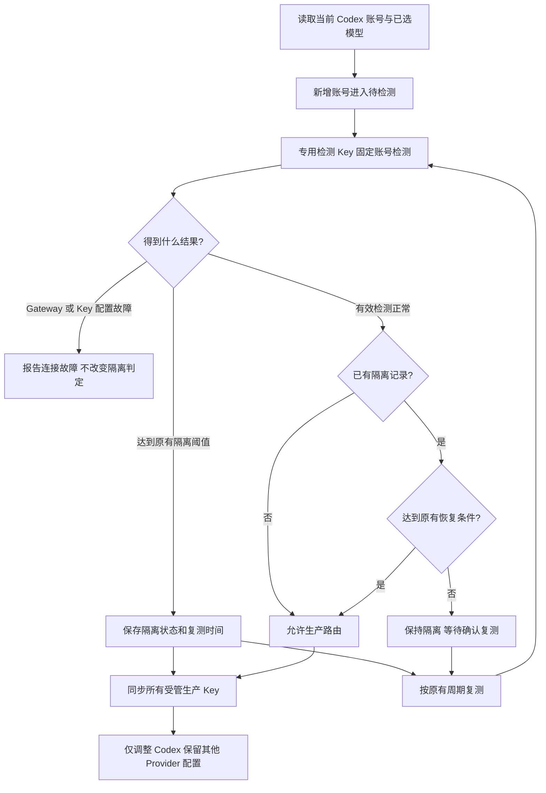

# Magpie Codex Guard

适用于 [Magpie](https://github.com/yetone/magpie) 的非官方 Codex 账号检测与隔离插件。

**自动发现 → 自动检测 → 自动隔离 → 自动解除隔离 → 自动同步生产路由。**

当前版本：**`v0.1.0-alpha.34`**。

默认通过模型指纹检测判断响应是否与预期模型一致：一次完整检测包含 3 次采样，评分在本地完成。保留原有普通客观题、自定义题库、隔离复测与恢复规则。本插件不保证模型指纹是百分之百准确的身份认证，请为检测模型选择合适的指纹参考。

## alpha.34 指纹数据库更新

- 将 [Ikaleio/lm-detector](https://github.com/Ikaleio/lm-detector) 固定到 2026-11-17 的 [`7663b658`](https://github.com/Ikaleio/lm-detector/commit/7663b6580cb6c9123da72e9218e700537544f1db)，指纹库从 **64 个模型更新至 72 个**。
- 新增 `openpangu-2.0-flash`、`openpangu-2.0-pro`、`muse-ember`、`claude-fable-5.2`、`gemini-4-carbon`、`gemini-4-hydrogen`、`gpt-6.2-sol`、`gpt-6.2-astra`，原有 64 个模型全部保留。
- 评分算法、指纹题三次采样以及隔离和恢复策略不变。已根据新版数据重新生成独立 JavaScript 结果，核对 Go 实现的预测、概率和分数。
- 更新参考库会改变部分旧模型的候选排名和概率；生产环境升级后应先在观察模式核实检测模型映射和结果，再启用自动隔离。

## alpha.33 的变化

- 检测凭证只有一个来源：管理页右侧选择的 **专用检测 Key**。不再重复输入 Gateway Key。
- 新增 Codex 账号自动继承已启用的 Codex 检测模型；新账号首次通过前保持待检测。删除账号停止检测，并在下次路由同步中移除。
- 生产 Key 的 Codex 勾选以有效检测状态为准。手动取消正常账号，下次同步勾回；手动勾选隔离账号，下次同步取消。没有预期账号数量、历史白名单审批或“采用当前白名单”操作。
- 重置只取消正在运行的检测、清空当前检测和隔离状态；**不恢复或修改生产权限**，也不清除历史或关闭已有调度设置。
- 只自动管理 Codex；不再由旧 API 上游隔离状态控制其他 Provider。保留其他 Provider 的管理员配置，以及全隔离时原有的动态路由组回退与保守保护。
- 路由写入中断后按最新检测状态和当前配置重新同步，不要求人工核对历史白名单。

## 安装与首次配置

在 Magpie 的插件安装入口填写：

```text
github:Dsd1001/magpie-codex-guard
```

也可通过 CLI 安装：

```sh
magpie plugin add github:Dsd1001/magpie-codex-guard
```

首次设置：

1. 在 Magpie 创建独立的检测 Key，允许访问所有待检测 Codex 账号和所选原生 Codex 模型，包括已经被生产路由隔离的账号。不要将业务 Key 当作检测 Key。
2. 从插件入口打开管理控制台。在「设置与路由」右侧选择一次 **专用检测 Key** 并保存；无需复制 Secret。
3. 左侧 Gateway URL 默认 **`http://127.0.0.1:3425`**，每日最多 **600 次上游请求**。按实际部署修改 URL 和预算；默认地址不可达时会报告连接故障，不会将其算作账号异常。
4. 在「账号监测」选择一个 Codex 检测模型，添加账号或批量加入已有账号。此后新增账号自动继承已启用的 Codex 模型，不需要再次确认。模型仍由管理员选择，插件不会猜测应使用哪种业务模型。
5. 在「检测题库」选择题目。全新安装默认只选择「模型指纹检测」；升级不改变已有题库。
6. 开启「自动检测调度」；需要自动管理生产路由时，再开启「自动隔离」。两者默认关闭，选择检测 Key 或题库本身不会自动启用生产隔离。

已保存的自定义 URL 优先于默认值。可以设置环境变量 `MAGPIE_CODEX_GUARD_GATEWAY_URL` 改变未配置 URL 时的默认值；不会覆盖已保存的自定义 URL。容器里的 `127.0.0.1` 指向容器本身，应填写插件进程实际可达的 Gateway 地址。

## 检测与判定规则

检测直接调用 Magpie 原生 `codex/<模型>`，通过 `X-Magpie-Account` 固定账号。检测失败不能换成其他账号完成同一采样。指纹评分器、参考库和原有判定阈值在本次重构中不变。

| 情况 | 行为 |
| --- | --- |
| 一轮指纹的 3 次采样完整，判定一致 | 记一次有效通过 |
| 一轮指纹的 3 次采样完整，可靠判定不一致 | 立即隔离 |
| 普通客观题连续 3 次有效错误 | 按原有规则隔离 |
| 429、上游超时等导致采样不完整 | 连续 3 轮不可用后按原规则隔离，不把不完整采样当作可靠指纹不一致 |
| 不可用后下一轮得到有效判定 | 按这一轮的一致／不一致处理 |
| 确认为上游账号的 HTTP 401／404 | 立即隔离 |
| 检测 Key 不存在、被禁用、没有账号／模型权限，或 Gateway 连接／鉴权配置错误 | 报告检测连接故障，不增加账号异常计数，不创建新隔离，也不解除已有隔离 |
| 隔离账号第一次有效通过 | 保持隔离，等待恢复确认 |
| 隔离账号按原规则连续两次有效通过 | 自动解除隔离并同步生产路由 |

Gateway 返回不明确的 401／404 时，插件会核对所选 Key 和模型列表，区分 Gateway 故障与上游账号错误。这个模型列表校验不是模型采样，不消耗上游采样预算。

待检测不等于正常；当前没有有效通过依据的 Codex 账号不会自动进入生产路由。已有正常依据的账号，在尚未达到原有隔离阈值的暂时失败期间，继续遵循原有状态机；隔离记录始终优先，必须达到恢复条件后才能放行。

手动客观题和手动指纹测试维持原有诊断用途：结果写入历史，不直接覆盖自动隔离状态。自动检测和隔离复测使用同一套选定题库与恢复规则。



## 检测 Key 的使用方式

`Route.ProbeKeyID` 是唯一持久化检测凭证配置。后端每轮开始时读取 Magpie 的当前 Key Secret，不再保存独立的 `Config.GatewayKey`。

手动检测、自动检测、指纹三次采样和隔离复测都使用这个 Key。一轮开始后固定使用同一份凭证；切换所选 Key 或轮换其 Secret 后，新一轮自动读取新凭证。正在进行的一轮不会混用新旧凭证；凭证失效导致该轮无法完成时按连接故障处理，不回退到生产 Key。

浏览器只接收 Key ID、显示名称和启用状态，不接收 Secret；日志和检测错误不会记录密钥明文。

## 自动账号管理与生产路由

同步范围是 **已启用、允许 Codex 模型的受管生产 Key**，专用检测 Key 排除在外。没有有效通过记录或仍被隔离的账号排除；正常账号和满足恢复条件的账号加入。管理员已经关闭的 Key 不会被擅自开启。

每次新的有效自动判定后同步路由；调度扫描也会按已保存状态修正生产 Key 的 Codex 勾选。新增生产 Key 自动按当前规则纳管。插件重启后沿用保存的有效状态与隔离时间，不依赖旧白名单，也不会因重启自动解除隔离。

只替换 Codex 账号勾选，不修改业务 Key 的 Secret、名称、计费字段和无关配置。其他 Provider 的账号选择保持原样；非 Codex 模型权限不因历史 API 隔离记录被删除。旧的 `baselines`、`expected` 或账号数量记录不能阻止同步；保留的写入记录仅用于事务恢复和撤销插件自己的临时限制。

手动勾选不是永久排除规则：下次同步会以检测状态为准。调度或文件写入错误会明确报告，并在后续扫描重试，不增加人工审批步骤。文件锁、原子替换、写后校验及未完成事务记录仍然保留。

### 全部 Codex 账号不可用时

Magpie 的空账号名单不能代表“禁止全部 Codex”：空名单或只列其他 Provider，都可能表示 Codex 不受限制。因此保留原有的全部隔离保护。

对于可安全处理的显式 Provider 模型权限，临时移除 Codex 权限，保留其他上游。对于保存的混合自动路由组，只临时关闭其 Codex 成员，保留其他可用成员、管理员原有 Off、成员顺序和路由策略。Provider、模型及路由组名称均从实际配置读取，不写死 Cybersol，也不要求路由组使用某个名称前缀。

例如同组包含 `codex/model-x`、`provider-b/model-y`、`provider-c/model-z`，全隔离期间只排除 Codex；模型名不必相同。账号恢复后撤销插件自己施加的临时限制，保留管理员期间对其他 Provider 作出的调整。

**保守边界保持不变：** 无限制模型权限、无法安全拆分的组别名／通配权限或没有安全回退成员时，不猜测或扩大访问范围。必要时仍临时关闭相应业务 Key，避免隔离账号被空名单放行；恢复后仅撤销插件自己的关闭。手动选择型路由组不支持相同的成员 Off 语义，不强行修改其策略。检测 Key 直接访问原生 Codex 模型，保持独立复测能力。

## 重置与独立路由同步

「重置全部账号检测／隔离状态」立即取消正在运行的请求，增加检测代次并丢弃尚未完成的旧结果。即使旧评分器不响应取消，其晚到结果也不能重新创建隔离或覆盖新一轮检测。

重置清空当前检测状态、失败／不可用／恢复计数和隔离记录，账号重新进入待检测；保留账号、题库、参考映射、检测配置、时间策略、历史记录和请求预算。现有调度及自动隔离开关保持不变。

**重置不读取或修改生产 Key，也不修改路由组。** 检测 Key 被删除、白名单被人工改过或旧路由事务未完成，都不是重置失败的理由。插件保留撤销临时限制所需的内部记录。重置后的自动路由写入等待新的有效检测判定；即使此时重启，也不会立即把所有账号当正常放行。

「按当前检测状态同步路由」是独立操作，可以明确按当前状态立即重算。重置后立刻执行同步时，仍待检测的账号会被排除，而不是恢复到历史白名单。原本开启的自动检测会继续运行，得到新结果后重新执行正常隔离／恢复流程。

## 自定义时间与预算

默认时间保持原有设置：

| 项目 | 默认值 |
| --- | --- |
| 正常账号检测 | 30 分钟 |
| 普通客观题失败后复测 | 2 分钟 |
| 隔离后首次复测 | 6 小时 |
| 隔离后持续异常复测 | 24 小时 |
| 恢复二次确认 | 2 分钟 |
| 不可用重试 | 30 分钟 |
| 单次请求超时 | 180 秒 |
| 调度扫描 | 60 秒 |

支持全局设置及单账号／模型覆盖；修改时间默认不会重排已保存的复测期限，除非勾选立即重新计算。每日预算按真实上游请求计数，一轮完整指纹通常消耗 3 次请求；达到预算上限不会作为账号异常计入隔离。

## 升级兼容与数据

升级保留已有专用检测 Key ID、模型、题库、检测历史、隔离状态和复测期限。旧的独立 Gateway Key 配置被废弃，后续保存不再包含其明文；没有已选专用 Key 的旧安装需要在下拉菜单选择一次，不能自动猜测业务 Key。

自动管理范围限定为 Codex。旧版登记的非 Codex API 上游仍可用于手动诊断，但不会参加自动隔离，也不会限制该 Provider 的业务模型；详见 [API 上游兼容说明](docs/api-upstreams.md)。

指纹库继续使用仓库中已固定的参考数据、原有评分器及独立评分一致性测试，本次不更新算法或题库。数据来源、版本和校验见 [指纹库来源](internal/fingerprint/data/ORIGIN.md)。

GitHub 源码安装会获取固定版本、固定 SHA-256 的预编译后端；完整 Release 包包含 Linux AMD64、Linux ARM64 和 macOS ARM64 后端。发布流水线在生成并上传对应安装包后更新源码安装器的版本及校验值，避免只升级管理页面而仍运行旧后端。

## 开发与测试

需要 Go 1.26 或更高版本，以及 Node.js 24。

```sh
npm ci
go test -count=1 ./...
go test -race ./...
go vet ./...
npm run check:js
npm run test:ui
npm run build:release
```

测试覆盖原有指纹采样与判定、普通题阈值、隔离复测及恢复，并覆盖新增账号、人工勾选纠正、全部隔离回退、任意 Provider／路由组、删除全部账号、重复同步、写入中断、重置抢占、重启、Key 切换／轮换和 Gateway 配置故障。

测试使用隔离的临时 Magpie 配置和模拟 Gateway，不会修改生产服务器或消耗真实账号模型额度。测试通过不等同于对所有第三方上游可用性的保证。

## 致谢与许可

感谢 [Magpie](https://github.com/yetone/magpie) 和 [lm-detector](https://github.com/Ikaleio/lm-detector)。插件许可见 [LICENSE](LICENSE)，随包参考数据及依赖许可见 `licenses/` 和指纹数据目录。
