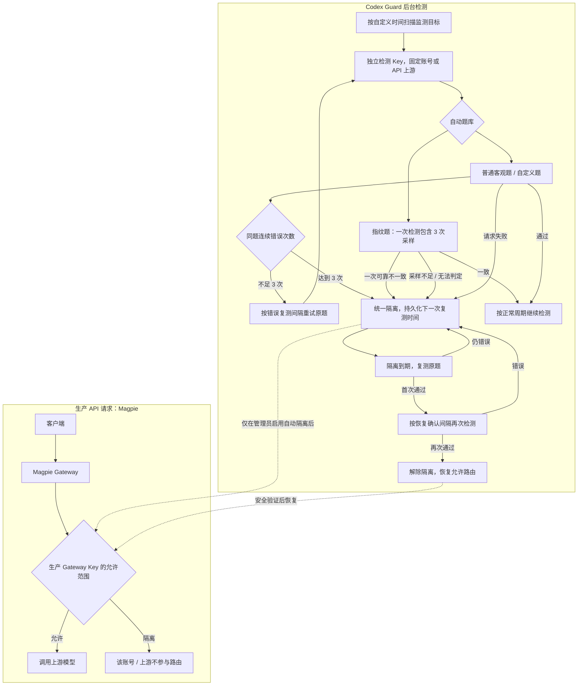

# Magpie Codex Guard

**非官方 Magpie 插件 · Codex 账号级质量监测与安全隔离**

*An unofficial Magpie plugin for per-account Codex quality checks, local fingerprint verification, and safe Gateway Key quarantine.*

Codex Guard 通过独立检测 Key 对 **Codex 登录账号与显式登记的 API 上游** 执行自动客观题检测。普通题同题连续 3 次错误会隔离；指纹题一轮进行 3 次上游采样，只要可靠判定不一致就立即隔离。它**不会删除账号或修改 OAuth 凭证**，也不是新的模型供应商。

**当前插件版本：** `0.1.0-alpha.22`。新版包含「自动检测不可用立即隔离」及指纹题与其他客观题并列配置。alpha.22 完整 Release 包含新后端；GitHub 源码安装器尚固定 alpha.20 后端，待 alpha.22 不可变资产发布并验证后更新固定校验。开启生产路由前请在观察模式验证。

## 快速安装

可以在 **Magpie → 设置 → 插件 → 发现 → 非官方插件 · GitHub** 中查找 **Magpie Codex Guard**（仓库添加 `magpie-plugin` Topic 并被 GitHub 索引后可见）。也可以直接在「已有想装的？」中填写：

```text
github:Dsd1001/magpie-codex-guard
```

**安装后按下面顺序配置：**

1. 在 Magpie 中准备一个**独立的检测 Gateway Key**，不要直接把生产业务 Key 当作检测 Key。检测连接输入的是 **Key Secret**；「专用检测 Key」下拉框选择的是该 Key 对象。
2. 在插件登录入口打开管理控制台：服务器本机访问可用本地地址，远程 VPS 请选「打开临时远程控制台（Cloudflare）」；不要在自己电脑浏览器里直接打开 VPS 的 `127.0.0.1`。
3. 在「账号监测」添加要监测的 Codex 登录账号和模型，在「检测题库」选择自动客观题并先进行手动测试。
4. 在「设置与路由」核对 **预期 Codex 账号数量**、独立检测 Key 与生产白名单。**只有明确勾选并确认后**，插件才允许自动修改生产 Gateway Key 的账号路由。
5. Magpie 增删 Codex 登录账号后，可点「同步 Magpie 账号」，或显式开启监测目标自动同步；如果你手动给生产 Key **增加**账号，还须点击「确认采用当前白名单」，由插件核对当前隔离状态后才更新私有路由基线。

详细原理、隔离间隔、安全限制和开发说明见下文。登录入口**仅用于打开管理控制台**，不会请求你授权其他第三方供应商。

## 功能概览

| 功能 | 具体行为 |
| --- | --- |
| 普通客观题 | 正常账号默认每 30 分钟检测；同题连续 3 次有效回答错误直接隔离 |
| 指纹客观题 | 与牛奶题、自定义题并列选择；每轮 3 次采样只算一道题，一次可靠不一致直接隔离；无独立指纹复核 |
| 模型自动匹配 | 优先根据 Magpie 检测模型自动解析指纹库类别；不支持的模型不发送自动指纹请求、不计失败 |
| 统一隔离和恢复 | 任何自动检测不可用也会立即隔离并按不可用重试间隔复测（默认 30 分钟）；其他隔离默认首次 6 小时、后续 24 小时，原题连续两次正确才解除隔离 |
| 检测时间自定义 | 正常检测、错误复测、隔离首次/后续复测、恢复确认、异常重试、请求超时、扫描间隔；支持全局与单目标覆盖 |
| 自定义题库 | 支持标准答案自定义客观题、轮换及手动检测；手动检测永不直接修改隔离状态 |
| 账号与路由安全 | 旧隔离记录跨重启保留；生产白名单扩大须管理员确认，且检测 Key 不受隔离影响 |

## 工作流程

Codex Guard 使用 **旁路质量检测 + 可选的生产路由隔离**，而不是对每次业务请求同步执行 `quality-check` 门禁。客户端仍直接调用 Magpie；**未检测或到期并不会由本插件直接返回 HTTP 403**。只有管理员明确启用自动隔离、并且路由安全校验成功时，检测结果才会改变受管理的生产 Gateway Key 白名单。



### API 上游检测

支持显式登记 Magpie API 上游，按指定 API Key 采样和自动判分。正常和不可用目标每 30 分钟检测；自动隔离以整个供应商为单位，保留专用检测 Key 的恢复访问。登记方法、隔离边界及安装包要求见 [API 上游说明](docs/api-upstreams.md)。

### 检测是怎么运行的？

1. **按账号独立采样。** 调度器按可配置扫描周期检查到期目标，通过独立检测 Gateway Key 和 `X-Magpie-Account` 固定账号；正常默认每 30 分钟运行一道自动题。
2. **指纹与普通题使用不同的隔离阈值。** 普通客观题失败后继续按自定义间隔复测同一道题，连续 3 次错误才隔离；指纹题一次包含 3 次独立采样且只算一次判分，完整可靠的 `mismatch` 直接隔离。隔离后不会再单独进行指纹复核。
3. **统一隔离和恢复。** 不再区分高低风险；默认隔离首次 6 小时、之后每 24 小时复测导致隔离的原题。连续两次有效正确（默认间隔 2 分钟）才恢复。429、超时和指纹无法判定都是中性结果。
4. **时间均可配置。** 管理控制台的「设置与路由 → 自动检测时间策略」提供全局默认和单账号覆盖。默认修改不影响已排定的下次复测时间；只有明确勾选重新排程才重算，且不会清除隔离记录。
5. **生产路由默认观察模式。** 只有管理员显式启用自动隔离并通过安全验证后，插件才会编辑生产 Gateway Key 的账号路由；检测 Key 保持允许隔离账号恢复检测。

**手动客观题和手动指纹检测只记录历史结果。** 指纹不再有独立的周期任务或失败后专门复核模式。已有隔离在升级时统一显示「已隔离」，保留原有下次检测时间，重启不重算。

## 只做 Codex 账号检测

- 从 Magpie 的 `logins.json` 只读提取 Codex 账号稳定 ID 和邮箱，**不导出 OAuth 凭证**。
- 「检测模型」直接读取 Magpie 自带的 `magpie models codex` 目录，显示当前实例中的 Codex 模型；**无需先配置检测 Key 才能选模型**。若本机无 Magpie CLI，则回退到已配置检测网关的 `/v1/models`。查询失败会在界面显示原因。
- 添加监测目标与真正发起检测分离：**实际探针仍必须配置独立检测 Gateway Key**，不会借用或暴露生产 Key。
- 每次通过独立 Gateway Key 的 `X-Magpie-Account` 固定一个订阅账号，账号无法解析就取消请求，不允许随机切换。检测请求使用原生 `codex/<model>` 名称，不再使用 `quality-probe/` 前缀，也不写入全局模型中间件；否则 Magpie 会对未知别名返回 HTTP 404。
- 统一检测题库：保留牛奶题、自定义自动判分题、内置模型指纹题。轮换支持多选；错误和隔离后复测同一题。指纹采样 3 次合并为一道题的判分，一次可靠不一致直接隔离；普通题要求 3 次连续错误。
- **普通客观题连续 3 次错误、指纹题一轮可靠不一致**时直接建立统一隔离记录；不会另发指纹采样做风险分级。生产路由自动隔离仍必须单独启用。
- Go 本地评分：使用固定版本的 `lm-detector shared-detector-v2`（60 个候选模型），不依赖官网评分 API，也不向外部评分服务发送账号或 Gateway Key。
- 自动隔离影响全部已管理的生产 Gateway Key，**检测专用 Key 保持可用**；不删除、不停用 Codex 登录本身。
- **管理员主动收缩白名单不会再导致全部检测停摆**：只接受现有显式白名单的顺序保留删除（不可变空、不可新增账号、不可更改启停状态），必须先用实时路由确认所有隔离账号仍被排除，才把收缩同步到插件私有基线并写审计日志；此操作不改写 Magpie Gateway Key 文件。未来解除隔离也不会恢复管理员移除的账号。
- 若外部修改涉及扩权、启停变化或不安全隔离，仍禁止自动路由覆盖；只有在可从实时 Key 文件验证全部隔离安全时，其他正常账号的**只读检测**可以继续运行，并禁止在此模式中产生可能无法执行的新隔离。
- **账号替换可恢复**：旧 Codex 登录已删除而仍有隔离时，插件保留原稳定 ID 与隔离历史（删除留档），跳过已不存在账号的自动检测，并持续阻止该 ID 重新进入业务路由。Magpie 恢复此 ID 时隔离仍有效，不会错误解除。可以选择手动同步或开启账号自动同步。
- 如果管理员在 Magpie 生产 Key 白名单中**主动加入新的、已登录且未被隔离的 Codex 账号**，可以在「设置与路由」点击「确认采用当前白名单」，在安全复核和明确确认后，仅更新内部基线和审计记录；此动作**不会写 Gateway Key 文件、不会清空旧隔离**，被删除的旧账号也不会从基线意外恢复。未知账号、被隔离账号、禁用状态变化与空白名单始终拒绝。
- 账号历史、统一隔离状态、下次复测时间、自定义时间设置均写入专用 SQLite 数据目录；服务重启后原样继续。

不再提供原插件的模型级质量门禁、模型级测试或 HTML/SVG 输出预览。**Cloudflare 远程控制台直接沿用原 Account Intelligence Check 的 Go 控制台与一次性会话机制**，不再使用独立 Node HTTP 代理。

## 检测题库中的指纹检测

指纹是**可选的一道自动客观题**，与普通客观题使用同一个调度器、隔离状态和恢复流程：

- 在「自动检测题」中与牛奶题、糖果题直接并列勾选「模型指纹检测」，也可以只选择指纹题。不存在单独的指纹开关、周期指纹检测或错误后指纹复核。
- 一轮指纹检测向同一指定账号发起 **3 次上游采样请求**，只有完整且可靠的 `mismatch` 才记为**一次错误，并立即隔离**；`match` 记正确，`indeterminate`、超时或采样不足不计错误次数，但自动检测会直接隔离，直至再次获得连续两次有效通过。
- 预期指纹模型**自动从检测模型映射**，例如 `codex/gpt-6.1-sol` 使用 `gpt-6-astra` 指纹库类别。只有无对应参考模型时才需要高级手动覆盖；缺少可靠参考将导致该轮自动检测不可用并触发隔离；请在开启自动指纹前核对模型是否受参考库支持。
- **普通客观题仍要求连续 3 次同题有效错误**。一旦隔离，按统一间隔复测**原来导致隔离的题目**；连续 2 次有效正确才恢复。手动检测只记历史。
- 所有有效判分、原始指纹样本、版本和隔离计划持久保存；指纹概率是参考库内的相对值，不能视为密码学身份验证。

## 自定义检测时间

打开「设置与路由 → 自动检测时间策略」，按全局或监测目标设置：

| 可自定义项 | 默认时间 |
| --- | ---: |
| 正常检测间隔 | 30 分钟 |
| 普通客观题错误后复测 | 2 分钟 |
| 统一隔离首次复测 | 6 小时 |
| 统一隔离后续复测 | 24 小时 |
| 隔离恢复二次确认 | 2 分钟 |
| 请求失败、429 或指纹无法判定重试 | 30 分钟 |
| 单次上游检测请求超时 | 180 秒 |
| 后台调度扫描间隔（全局） | 60 秒 |

时间支持秒、分钟、小时和天的适用单位。监测目标可继承全局值，也可单独覆盖；扫描频率始终为全局设置。配置经过后端安全范围校验，日请求预算不因缩短时间而绕过。**默认只影响下一次完成检测后的排程**；可主动勾选「保存后重新计算未执行的任务时间」，但不会清空已有隔离、失败次数或恢复确认次数。

## 统一隔离和恢复规则

| 场景 | 行为 |
|---|---|
| 普通客观题第 1、2 次错误 | 按可配置间隔复测同一道题 |
| 普通客观题第 3 次连续错误 | 直接隔离，不额外做指纹复核 |
| 指纹题一次完整、可靠判定不一致 | **立即隔离**（已包含 3 次采样，不再要求连续 3 轮） |
| 隔离到期复测 | 复测导致隔离的原题；首次正确后按恢复确认间隔再测 |
| 连续 2 次有效正确 | 解除持久化隔离并恢复允许的生产路由 |
| 429、超时、指纹不可判定、采样不足或无有效答案 | **立即隔离**，不计错误次数；到期重测原题，连续两次有效通过才恢复 |

### 所有账号都被隔离时会怎样？

Magpie 的 Gateway Key 账号白名单遵循 **“空列表允许全部账号”**，且仅列出其他 Provider 的账号也不会禁止 Codex，因此绝不写入空白名单或伪造不存在的 Codex ID。

如果某个生产 Key 已没有任何允许的健康 Codex 账号，**Codex Guard 会把该生产 Key 暂时设为 `off=true`**；这会使该 Key 关联的其他 Provider API 也一起暂停。专用检测 Key 始终保持启用状态。健康账号恢复后，插件还原该 Key 最初的 `off` 状态和账号范围；原本就停用的 Key 不会被误开启。全部变更使用 Magpie 相同的文件锁、原子写入、写前日志和写后验证。

只有**通过受管理的 Gateway Key** 进入的业务 API 会受到限制。绕过这些 Key 的直连、未管理的 API 入口不受本插件保证。

## 直接在 Magpie 中安装（GitHub）

**版本说明：** `v0.1.0-alpha.22` 完整包新增「自动检测不可用立即隔离」，自动题库中的「模型指纹检测」与其他题直接并列勾选。源码安装器须在 alpha.22 发布并核验后固定到新后端。在此之前源码安装仍使用已校验的 alpha.20 后端。升级保留已有隔离和自定义时间。

在 **Magpie → 设置 → 插件** 页面底部的「已有想装的？」输入框中粘贴：

```text
github:Dsd1001/magpie-codex-guard
```

点击「安装」。也可在运行 Magpie 的环境里使用：

```sh
magpie plugin add github:Dsd1001/magpie-codex-guard
```

**不需要**手工下载 Release、执行 Go 构建或运行 npm。Magpie 通过 Bun 获取 GitHub 仓库，且不会执行包的安装脚本；本插件在首次启动时从 [v0.1.0-alpha.20 Release](https://github.com/Dsd1001/magpie-codex-guard/releases/tag/v0.1.0-alpha.20) 下载所需的预编译程序，对安装包以及三个平台二进制分别校验固定 SHA-256，之后缓存在按后端版本隔离的数据目录中。后续启动直接复用缓存。支持 Linux AMD64、Linux ARM64 和 macOS ARM64，其他平台目前不受支持。**首次启动必须能访问 GitHub Release 下载地址，且容器内需要 `tar`。** 此处使用已发布并校验的 alpha.20 后端，是为了避免源码安装器依赖尚未发布的文件；alpha.21 Release 完整包则优先使用内部包含的本次 Go 后端。

**生产环境警告：** 安装不等于立即启用自动隔离；应先保持观察模式，不要让旧版与新版同时写入生产 Gateway Key。需要配置独立的检测 Gateway Key 并完成真实账号安全校验后，才能手动启用自动路由。

**Docker 远程控制台：** 在 Magpie 的插件登录列表中，选择 **「打开临时远程控制台（Cloudflare）」**，等待生成 `https://随机子域名.trycloudflare.com/open/...` 一次性链接，在自己浏览器打开即可；不要选择只适用于服务器本机的 `127.0.0.1` 入口。首次使用时自动下载校验 Cloudflare 官方 `cloudflared 2026.10.0`，无需 Cloudflare 账号、额外 DNS 记录或暴露入站端口。远程临时隧道最长 30 分钟，管理链接 10 分钟内有效且只能使用一次，登录会话 30 分钟自动过期。插件会在外网健康检查通过后才返回链接。

注意：Cloudflare 承担 HTTPS 转发，控制台内可修改业务路由，因此一次性链接视为管理凭证，不能公开分享。**Go 控制台始终监听 `127.0.0.1`，Cloudflare 官方客户端直接将随机 HTTPS 域名转发到该端口**；Go 服务复用原插件已验证的 Host/Origin、一次性登录和会话校验逻辑。测试期间请先保持**自动隔离关闭**；升级已安装的 Codex Guard 后，必须重新进入插件登录流程，旧的本机 URL 不能变成公网 URL。


### 上线前安全要求

1. 备份生产 `caller-keys.json`、旧插件数据库和历史隔离列表。
2. 完成服务隔离的迁移窗口，确保旧、新插件 **不会同时修改相同生产 Gateway Key**。在确认新插件接管之前，必要时暂停业务 Gateway Key，避免临时放行旧隔离账号。
3. 确认 Magpie 版本支持稳定账号 ID、专用 Gateway Key、`X-Magpie-Account` 固定账号和文件锁语义。
4. 先开 **观察模式**。用真实账号验证指纹判分、统一隔离机制及容器资源上限，再显式启用自动隔离。
5. 模型指纹是参考库内相对统计排名，**不是账号身份的密码学验证**。当前评分器的强不一致阈值为候选排名首位概率至少 0.90、预期类别概率低于 0.03；启用指纹单轮自动隔离前应先在观察模式做真实账号验证。
6. 预留管理后台的紧急恢复能力。发生外部改动或写前日志未结束时停止自动覆盖并要求人工核对。

## 测试覆盖

- 普通客观题同题 3 次失败直接隔离，无额外指纹请求；路由安全隔离与两次正确恢复。
- 指纹题一轮 3 次采样、一次可靠不一致直接隔离；采样不足或不可判定不累计错误，但自动检测不可用会隔离。
- 默认与单监测目标自定义时间、重启持久化、默认保留旧排程和可选重新排程。
- 旧高低风险隔离记录迁移为统一隔离时保留原定复测时间及生产路由。
- 所有账号隔离时生产 Key 安全暂停、恢复后允许路由复原、外部修改冲突保护。
- 16 组公开参考回答与原版 lm-detector JavaScript 分数及排序对比；jsdom 进行管理页面安全、题库和时间配置冒烟测试。
- 临时 Cloudflare 控制台与本地管理会话验证。

详见 [设计与迁移说明](docs/architecture.md)。

## 许可证与致谢

MIT。原插件源码的许可声明见 [LICENSE](LICENSE)，lm-detector 评分算法和参考数据的许可声明见 [licenses/lm-detector.MIT.txt](licenses/lm-detector.MIT.txt)，自动下载的 Cloudflare 官方 `cloudflared` 使用 Apache 2.0，完整许可文本见 [licenses/cloudflared.apache2.txt](licenses/cloudflared.apache2.txt)。上游是算法/数据的来源，**不提供远程评分 API**，本项目不会向上游站点发送生产 Key。
